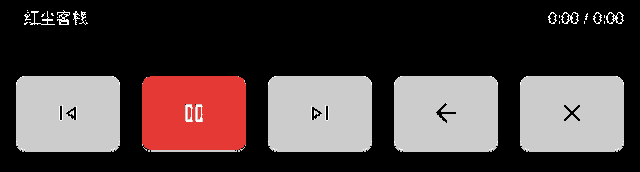
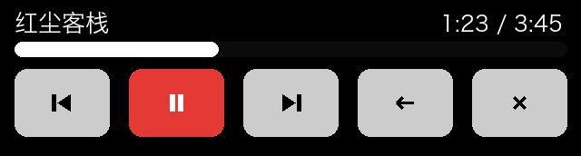
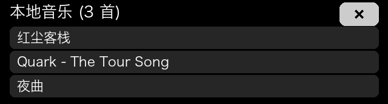
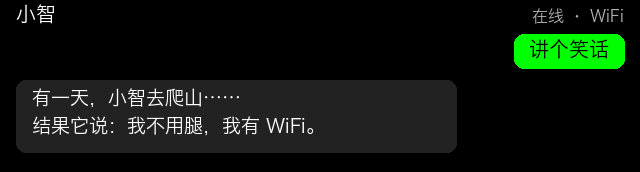

# 小智 AI 桌面机器人 · 定制固件

> 适配 **微雪 Waveshare ESP32-S3-Touch-LCD-3.49** 的定制固件
> 基于开源项目 [xiaozhi-esp32](https://github.com/78/xiaozhi-esp32) **v2.4.2** 二次开发 · MIT 协议

在保留小智全部原有对话功能的前提下，增加了**待机翻页时钟**、**SD 卡本地音乐播放器（自动续播）**，并把音乐界面改成了深色主题。

音频链路**保持原厂**：没有加任何增益、压缩或限幅。为什么最后决定不加，见文末「[一次长达一天的音频失真排查](#-一次长达一天的音频失真排查)**」。

---

## ✨ 特性

| 功能 | 说明 |
|---|---|
| 🕐 **待机翻页时钟** | 进入待机 3 秒后自动出现。左侧竖排「月 / 日」，中间 140 px 大号翻页数字，右侧竖排「星期 + 农历」。纯黑底 + 深灰卡片 + 白字，深夜不刺眼 |
| 📅 **农历显示** | 内置 1900–2100 年农历数据表，纯本地整数换算，不联网、不依赖服务端 |
| 🎵 **SD 卡本地音乐** | 自动扫描 TF 卡根目录 `.mp3`，支持中文歌名，可上一首 / 下一首 / 暂停 |
| 🔁 **自动续播** | 一首播完自动接下一首，最后一首播完回到第一首循环，不用手动点 |
| 🌙 **音乐界面深色主题** | 纯黑背景、白色文字、浅灰按钮、红色播放键 |
| 🎤 **播放音乐时忽略唤醒词** | 防止喇叭声音被麦克风拾取导致自问自答；暂停时仍可正常唤醒 |
| 🖼️ **字幕背景透明** | 主界面聊天字幕不再有奶白色衬底，壁纸完整显示 |
| 🎨 **可换表情包** | 支持官方控制台生成的 128×128 GIF 表情包 |
| 🔊 **音频链路原厂** | 不加增益、不做压缩、不设音量上限 —— 音乐和语音都跟随你设的系统音量 |

---

## 📷 界面预览

<table>
<tr>
<td align="center" width="50%">

**待机翻页时钟**<br>
<br>
<sub>真机截图 · 640×172</sub>

</td>
<td align="center" width="50%">

**音乐界面**<br>
<br>
<sub>真机截图 · 640×172</sub>

</td>
</tr>
<tr>
<td align="center">

**音乐播放中**<br>
<br>
<sub>示意图（按源码布局配色绘制）</sub>

</td>
<td align="center">

**歌单列表**<br>
<br>
<sub>示意图（按源码布局配色绘制）</sub>

</td>
</tr>
<tr>
<td align="center" colspan="2">

**小智主界面（原厂对话功能完整保留）**<br>
<br>
<sub>示意图（按源码布局配色绘制）</sub>

</td>
</tr>
</table>

> 📌 标注「真机截图」的两张是从板子 framebuffer 直接抓出的原始像素；标注「示意图」的三张是按固件源码里的真实布局常量和配色值绘制，用于展示截不到的界面状态。

---

## 🔧 适配硬件

| 项目 | 规格 |
|---|---|
| 开发板 | 微雪 Waveshare ESP32-S3-Touch-LCD-3.49（V1） |
| 主控 | ESP32-S3R8 · 双核 LX7 240 MHz · **8 MB PSRAM** · **16 MB Flash** |
| 屏幕 | 3.49 寸 IPS 172×640（AXS15231B，QSPI），固件内横屏使用 640×172 |
| 触摸 | AXS15231B 电容触摸（I2C 地址 0x3B） |
| 音频 | ES8311（DAC）+ ES7210（ADC）+ 板载喇叭 |
| 存储 | TF 卡槽（音乐） |
| 电池 | 板载电池接口 + ADC 电量检测 |

> ⚠️ **必须是有 16 MB Flash 的版本**。8 MB Flash 版本无法容纳分区布局。

---

## 🚀 快速开始

### 方式一：全量刷机（推荐给新板 / 想从干净状态开始）

```bash
esptool.py --chip esp32s3 -p <你的串口> -b 460800 \
  write_flash 0x0 xiaozhi-3.49-custom-full.bin
```

- 串口示例：macOS `/dev/cu.usbmodem****`，Windows `COM3`
- 这个包包含 bootloader + 分区表 + 启动槽信息 + 应用固件
- **⚠️ 会清空 WiFi 配置和激活状态**（包内 NVS 区已置空，同时也是为了不携带任何人的凭据），刷完需要重新配网激活

### 方式二：只刷应用固件（推荐给已经能正常开机对话的板子）

```bash
esptool.py --chip esp32s3 -p <你的串口> -b 460800 \
  write_flash 0x20000 xiaozhi-3.49-custom-app.bin
```

- **不会动 WiFi 配置、激活状态、表情包、壁纸**
- 刷完直接重启即可

### 校验文件完整性（建议）

在发布包根目录执行：

```bash
shasum -a 256 -c SHA256SUMS.txt
```

两个文件都应输出 `OK`。v1.2 的期望值：

| 文件 | 大小 | sha256 前 16 位 |
|---|---|---|
| `xiaozhi-3.49-custom-app.bin` | 3,158,096 字节 | `0587e412b12e1e99` |
| `xiaozhi-3.49-custom-full.bin` | 3,289,168 字节 | `2d9beaef134865f3` |

### ⛔ 千万不要刷的分区

| 地址 | 内容 | 为什么不能刷 |
|---|---|---|
| `0x800000` | assets 分区 | 里面是字体、表情 GIF、唤醒词模型、壁纸。刷错版本会改掉桌面图标、字体大小、唤醒词 |

**只需要换表情包时**，用官方控制台（xiaozhi.me）生成你自己的 `assets.bin` 再单独刷到 `0x800000`，并且**必须先擦除整个 8 MB 分区再写入**：

```bash
# 先擦除整个 assets 分区
esptool.py --chip esp32s3 -p <串口> -b 460800 erase_region 0x800000 0x800000
# 再写入你生成的 assets.bin
esptool.py --chip esp32s3 -p <串口> -b 460800 write_flash 0x800000 assets.bin
```

> 只写不擦的话，旧的资源文件会残留在分区后半段，和新的文件系统撞对象 ID，可能出现「表情没变」甚至挂载失败。

---

## 📱 首次开机

1. 插电开机，设备进入配网模式（屏幕/官方文档有提示）
2. 手机连接设备热点，按提示输入家里的 WiFi 名称与密码
3. 打开 [xiaozhi.me](https://xiaozhi.me) 控制台添加设备，屏幕会显示 6 位验证码，填入完成激活
4. 激活后说「**你好小智**」即可开始对话

> 配网与激活流程以官方文档为准，本固件未做任何改动。

---

## 🎮 使用说明

### 待机时钟
- 进入待机 **3 秒**后自动出现，不用任何操作
- 触摸屏幕或按 **BOOT 键** → 立刻回到对话界面
- 时间自动与服务器时间同步，**不需要手动设置**

### 音乐播放器
- 把 `.mp3` 文件拷到 TF 卡**根目录**（支持中文文件名）
- 进入音乐界面后自动列出全部歌曲
- **音量跟随系统音量**（本固件不做任何限制或压缩）
- **自动续播**：一首播完自动接下一首，最后一首播完回到第一首
- 播放期间：
  - **唤醒词暂时失效**（防止喇叭声被麦克风拾取）；暂停状态下仍可唤醒
  - 按 **BOOT 键** 仍可手动唤起对话
- 退出音乐界面 = 停止播放

### 音量
- 说「**音量调到 90**」或在 App 里调，语音和音乐都跟随这个值
- 建议从 **85~90** 开始试。如果你的机器音量开到 95 以上会出现「发毛」式失真，
  先看下一节的排查方法 —— 那大概率不是软件问题

---

## 🩺 声音「发毛 / 破音」排查（先做这个，30 秒）

**如果播音乐或小智说话时出现持续的「发毛、发破」声，先用手按住外壳。**

- **按住就好、松开又坏**，或者按压位置/力度不同声音不同 → **机械共振**，不是固件问题
- 本板最常见的原因是：**喇叭和硬壳之间那层缓冲胶老化变薄**，喇叭与外壳形成刚性接触，
  升温后（热膨胀）开始共振。所以症状是「用几分钟后才出现、凉了会恢复、重启没用」

**处理**：拆开，在喇叭四周贴一圈 **1~2 mm 厚的泡棉双面胶**（或 EVA 泡棉）做柔性缓冲。
注意**别把喇叭背面完全封死**，小喇叭需要留一点空气腔，封死了声音会变闷、低频消失。

贴完之后整首歌、整段对话都应该干净，音量也可以正常开到 90~95。

> 这个问题很能迷惑人：数字信号完全干净（峰值、RMS、满幅样本都正常），
> 换音乐、降音量、重启全都无效，只有物理处理有效。详细排查过程见文末。

---

## 📊 实测数据

所有参数都来自真机测量，不是估算值。

### 机械共振的确诊过程

| 观察 | 数据 / 现象 | 排除了什么 |
|---|---|---|
| 数字信号峰值 | 31%~58%（音乐）、43%~73%（语音），无满幅样本 | 数字削波 |
| 音量 | 全程稳定在设定值（90/95），NVS 与硬件一致 | 音量漂移 |
| 内部 RAM | 对话期间 14 KB 稳定不降 | 内存泄漏 |
| 电池电压 | 4.07~4.11 V 全程稳定 | 电源跌落 |
| 换成音乐（另一条独立链路） | **同样失真** | TTS 链路、解码、语音增强 |
| 静置 10 分钟 | 一开始干净，40 秒后又失真 | 编解码器寄存器状态 |
| 重启 | **不能恢复** | 软件状态 |
| **按住外壳** | **失真立刻消失，松开又出现** | **⇒ 机械共振** |

**结论**：数字侧全程干净，失真发生在 DAC 之后的模拟/机械环节。
原厂喇叭与硬壳之间的缓冲胶老化变薄 → 刚性接触 → 升温后共振。换泡棉后彻底解决。

### 音量与失真出现时间的关系（同一个机械故障下的表现）

| 系统音量 | 连续对话多久出现失真 |
|---|---|
| 95 | 约 1 分钟 |
| 90 | 约 6~10 分钟 |
| 85 | 数分钟内未见 |
| 75（音乐） | 约 90 秒（冷机后） |

音量越大机械激励越强，越容易把松动的部件振起来 —— 所以这是「激励强度」问题，
不是功放削波。**缓冲胶处理好之后，这些限制都不需要了。**

### 语音响度增强：做了，但最终关闭

为了让小智说话更响，曾实现过一个「抬 RMS + 峰值限幅」的语音增强模块，实测数据：

| 版本 | 输出峰值 | 输出 RMS | 问题 |
|---|---|---|---|
| 原始语音 | 43% | 8.5% | 干净但偏轻 |
| 第一版 | **89%（顶死天花板）** | 15.1% | 上板即爆音 |
| 第二版 | 70.0% | 13.7% | 短对话正常，长对话渐爆 |
| 第三版 | 68.6% | 13.3%（+3.9 dB） | 增益跨句累积，2 分钟后爆 |
| 第四版 | ≤50%（硬顶） | ~10% | 固定峰值上限让限幅器全程工作，反而更早爆 |

**最终结论：在音源电平剧烈变化的场景（TTS 逐句响度能差一倍以上），
「自动增益 + 固定峰值上限」这个组合在这个硬件上无法做到既不爆音又更响。**
所以该模块保留在源码里但**默认关闭**（`voice_enhance.cc` 里 `kEnabled = false`），
音频原样输出。想要更响，直接调系统音量 —— 那是唯一干净的手段。

---

## ⚠️ 已知限制

1. **板载喇叭的机械装配对音质影响很大**：缓冲胶老化后会出现「发毛」式失真，见上一节。这是硬件问题，软件无法修复。
2. **音乐只支持 TF 卡本地文件**：网络电台功能已被移除（只保留本地播放）。
3. **表情包需要官方控制台生成**：21 个情绪名称固定（`neutral` `happy` `sad` …），官方的生成器要求必须提供一张 neutral 图，未指定的情绪会回落到 neutral。
4. **`robot_2` 情绪无对应图片**：服务端会下发这个名称，官方表情包里没有，会回落到字体符号显示。
5. **电量是 ADC 软件估算**：本板没有充电检测引脚，充电状态判断不准确。
6. **只在本板实测**：其他型号的板子引脚、屏幕、音频链路都不同，不能直接刷。
7. **待机时钟字体**：使用 **Liberation Sans Bold**（SIL OFL 1.1）生成的位图字体，与 Arial 度量兼容，可自由分发。详见 [docs/字体授权说明.md](docs/字体授权说明.md)。

---

## 🛠️ 从源码编译

```bash
# 需要 ESP-IDF v5.5.2
git clone https://github.com/78/xiaozhi-esp32.git
cd xiaozhi-esp32
git checkout v2.4.2

# 套用本项目的改动（见 source/修改文件清单.md 与 source/xiaozhi-3.49-custom.patch）

idf.py set-target esp32s3
idf.py build
```

### 关键 sdkconfig 项

```
CONFIG_FATFS_API_ENCODING_UTF_8=y     # 中文歌名必须（关键！不是代码页问题）
CONFIG_FATFS_LFN_HEAP=y
CONFIG_FATFS_CODEPAGE_437=y
CONFIG_SPIRAM_USE_MALLOC=y
CONFIG_LV_USE_SNAPSHOT=y
```

Wi-Fi 缓冲区需要在 `CMakeLists.txt` 里通过 `idf_build_set_property` 注入，因为它没有暴露在 Kconfig 里：

```cmake
idf_build_set_property(COMPILE_DEFINITIONS
  "CONFIG_LWIP_TCP_SND_BUF_DEFAULT=32768;CONFIG_LWIP_TCP_WND_DEFAULT=32768;CONFIG_LWIP_TCP_RECVMBOX_SIZE=16" APPEND)
```

---

## 🧪 一次长达一天的音频失真排查

这部分是踩坑记录，对玩这块板的人应该有用 —— **最有价值的一条是：先按外壳。**

**症状**：小智说话一开始正常，连续对话一段时间后出现持续的「发毛」失真，之后不再恢复。

**走过的弯路**（全部无效）：

| 尝试 | 结果 |
|---|---|
| 加语音增益（四版迭代） | 每版都爆，只是爆的时间点不同 |
| 改增益限速方向（压得快、放得慢） | 短对话好了，长对话照爆 |
| 加句间归位（300 ms 时间戳） | 六轮自测数字完全一致，真机 2 分钟后照爆 |
| 把峰值上限从 0.70 压到 0.50 | **反而更早爆**（固定上限让限幅器全程工作） |
| 完全旁路（一个样本都不改） | 仍然爆 ⇒ 证明不是软件 |
| 降系统音量 95 → 90 → 85 | 爆的时间点被推迟，但治不了根 |
| 换音乐播放（另一条链路） | 同样爆 ⇒ 证明不是 TTS 链路 |
| 静置冷却 / 重启 | 冷却有效、重启无效 ⇒ 证明是热 + 硬件 |

**最后 30 秒定案**：失真时按住外壳 → 失真消失；松开 → 又出现。
拆开发现喇叭与硬壳之间的缓冲胶已经老化变薄，换泡棉后**整首歌无失真**。

**留给以后的判据**（从上到下，越靠前越便宜）：

1. **按住外壳，失真变化** → 机械共振，软件无解
2. **换另一条音频通路也失真** → 模拟侧（编解码器 / 功放 / 喇叭）
3. **数字侧峰值/RMS/音量全程平稳但人耳失真** → 失真在 DAC 之后
4. 以上都排除了，才去怀疑算法、缓冲、内存

---

## 📄 许可与致谢

- 本项目基于 [xiaozhi-esp32](https://github.com/78/xiaozhi-esp32)（MIT），遵循 **MIT 协议**
- 硬件设计 © [微雪电子 Waveshare](https://www.waveshare.com/)
- 图形库 [LVGL](https://lvgl.io/)（MIT）
- 音频前端 [ESP-SR](https://github.com/espressif/esp-sr)（Espressif）
- 唤醒词「你好小智」由官方模型提供
- **时钟字体：[Liberation Sans Bold](https://github.com/liberationfonts/liberation-fonts)（SIL Open Font License 1.1）**
  —— 与 Arial 度量兼容的开源字体，可自由使用与再分发。详见 [docs/字体授权说明.md](docs/字体授权说明.md)

如果你基于本固件继续修改，请同样保留 MIT 协议与以上致谢。

---

## 📝 更新记录

见 [CHANGELOG.md](CHANGELOG.md)
